<p align="center">
  <picture>
    <source media="(prefers-color-scheme: dark)" srcset="docs/assets/logo/castpane-lockup-on-dark.svg">
    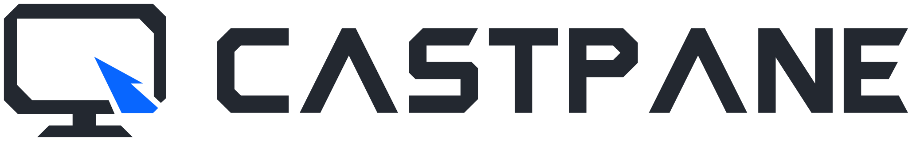
  </picture>
</p>

<h1 align="center">Castpane</h1>

<p align="center">
  <b>See and control your own Mac from a phone or another computer.</b><br>
  One app on the Mac, a browser on the other side, nothing else to install.
</p>

<p align="center">
  English · <a href="README.zh-TW.md">繁體中文</a>
</p>

---

## What it is

Castpane lets you see and control your own Mac from a phone or another computer. You open it
in a browser, or install it on the phone's Home Screen as an app. The Mac runs one app,
**Castpane.app**. The phone or the other computer needs nothing installed.

The picture is the Mac's own hardware HEVC or H.264, decoded by the browser's hardware decoder,
up to the Mac's full Retina resolution (3840 × 2160's pixels), so a whole screen or a single window stays sharp and current
on a phone. When the screen stops changing, the picture sharpens within about a second. You click, scroll and type
back, with touch modes made for a small screen.

> [!WARNING]
> Castpane gives whoever signs in to its account full control of your Mac, as you. Use a strong
> password, turn on two-step sign-in or a passkey, and read [docs/security.md](docs/security.md)
> before you open it to the internet. It cannot protect you from other programs that already
> run on your Mac under your account.

<p align="center">
  <picture><source media="(prefers-color-scheme: dark)" srcset="docs/assets/architecture-dark.png">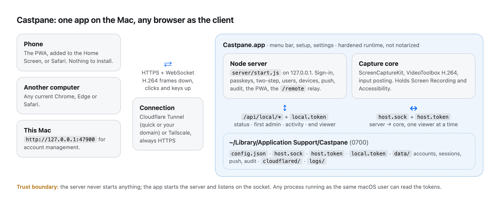</picture>
</p>

## Two halves

|                                    | What                                                                                                                                                                                                                                                          | Where                                   |
| ---------------------------------- | ------------------------------------------------------------------------------------------------------------------------------------------------------------------------------------------------------------------------------------------------------------- | --------------------------------------- |
| **Castpane.app** (the server side) | A menu-bar app. It captures the screen with ScreenCaptureKit, encodes it with VideoToolbox and posts your clicks and keys. It runs the web server, keeps it running, and manages the connection (a Cloudflare tunnel, or the address you give for Tailscale). | [`mac/`](mac/) and [`server/`](server/) |
| **The PWA** (the client)           | A web app in Vue and Framework7: sign-in, the Remote page and settings.                        Any current Chrome, Edge or Safari, on a phone or a computer.                                                                                                     | [`web/`](web/)                          |

## Features

<p align="center">
  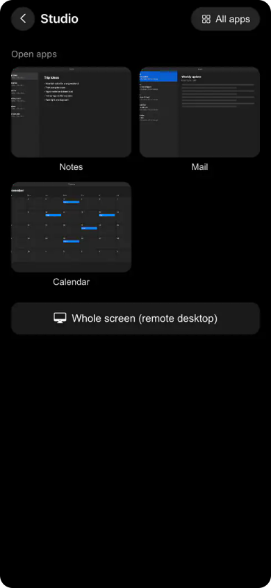
  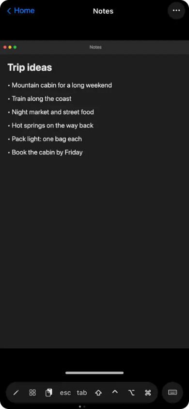
  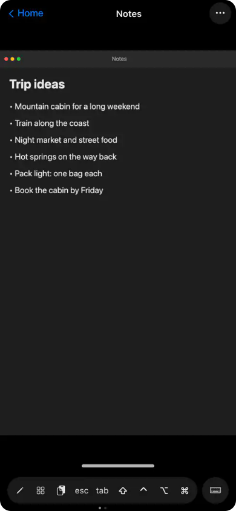
</p>
<p align="center">
  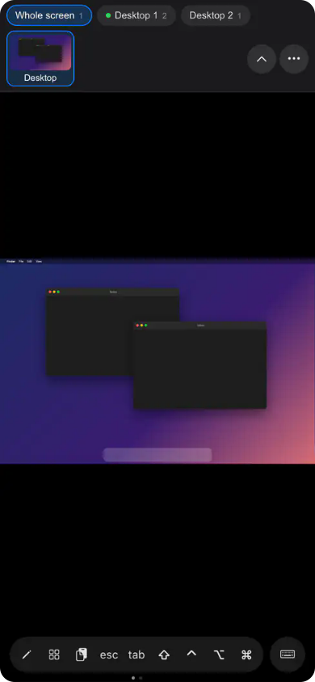
  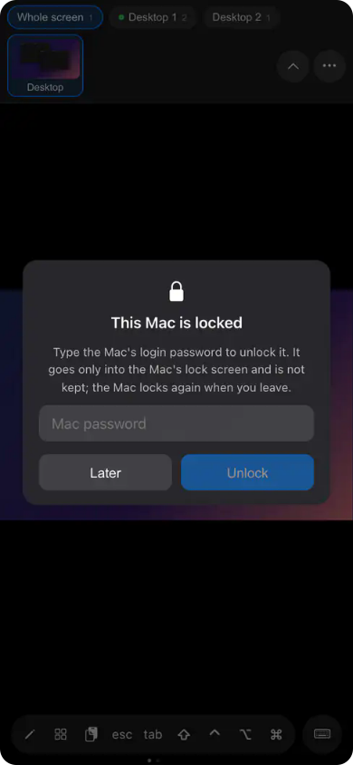
</p>
<p align="center">
  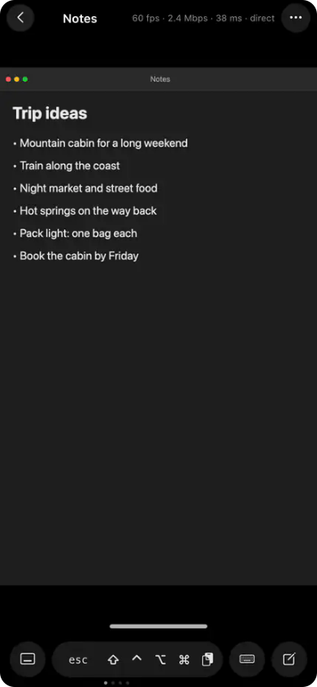
  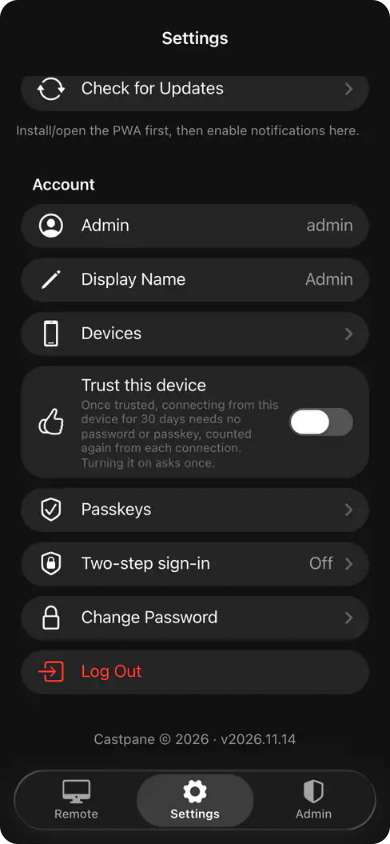
</p>

- **The Mac's apps, as a phone's.** The Remote tab opens on the apps open on the Mac, one card
  each. Three filters pick all of them, those on a desktop, or those in the Dock; on a phone
  the cards sit two a row or one. The Mac's Dock stays open at the left: its apps (a dot beside
  those running), the windows put in it, then the folders and files kept there and the Trash,
  opened in the Finder (a file as a double click would open it, so an app or a script kept
  there runs); the Mac's Apps or Launchpad opens All apps. A card shows the number of its windows at the top
  right; held, it offers to put its window in the Dock or close it; a card with several asks
  which one, with Quit app and Force quit at the foot. A window an app keeps hidden gets no
  card.
- **Every app.** All apps opens a panel over the home, as the Mac's Apps window: a search
  field, the apps running in a row, then every app; one not running starts, says so while it
  does, and its window opens as soon as it has one.
- **Made the device's shape.** Tap an app and its window fills the screen, made the shape of
  this device on the Mac, so its text and buttons are the size of the device's own apps, and
  you use it with your finger, with no pointer to move. An app that cannot be that narrow keeps
  the width it can have and is made as close as it allows. What the app opens over its window
  (an alert, a sheet, a menu, or another of its windows over that place) shows in the picture
  too, cut to the window; another app's dialog,
  such as a permission prompt, does not. With the keyboard up, the window is
  made the shape of what is left above it. The window goes back as it was when you leave it. An
  app's menu can leave that app at its own size from then on, or turn the fitting off;
  **Settings › System › Apps left at their size** lists them.
- **Moving between apps as on a phone.** Slide the bar at the bottom sideways for the app used
  before or after, up for the open windows as cards (tap one to open it, slide one up to close
  that window on the Mac, hold one for more), or slide in from the left edge for the home.
- **Windows, the Dock and quitting.** An app's menu puts its window in the Dock, closes it,
  quits the app as ⌘Q does (asked first; an app that stays, asking something on the Mac, is
  said so, with the whole screen a tap away), or forces it to quit at once, warned first that
  nothing unsaved is kept. The Dock, the yellow button, Minimize and the quitting need the Mac
  app from this version on; an older Mac shows the rest.
- **The whole screen too.** One button at the top of the home shows a whole display, or all of
  them side by side. **Settings › System › Whole screen lists app windows too** lists the
  desktops (Spaces), full-screen apps and every window there as well, grouped by desktop with
  thumbnails. A window on another desktop, or one its app keeps closed in the background, comes
  up as a click on its Dock icon brings it; when you leave or turn to another, it goes back out
  of sight as it was.
- **Asleep or locked.** Connecting wakes the Mac's display, and it stays on while you watch.
  A locked Mac asks for its password in a small window and unlocks; it locks again when you
  leave, or when the phone drops off the network.
- **Made for a phone.** Three touch modes: tap where you want (direct), a trackpad, or a
  pointer you drag by a ring below it, so your finger never hides what it points at. Pinch to
  zoom, or pick a size in the menu; when you tap a text field the keyboard comes up and the
  field is zoomed into view. The keys a phone lacks sit in one capsule you slide sideways, four
  pages of them: esc, ⇧ ⌃ ⌥ ⌘ and the clipboard; delete, home, end, page up and down; the
  key panel, Mission Control, the Mac's desktops, return and ^C; the arrows and tab (a tablet
  fits them all at once). Round buttons sit beside it: the Mac's Dock at the left, at the right
  one to call up or hide the keyboard and one to open a card to write in. The row is yours to
  arrange in Settings › Remote › Key row, any key on any page or as a round button (one at the
  left, two at the right), and the account keeps it, so every device shows the same, changed on all of them at once. The card
  writes several lines, input method and all:
  Send types it where the Mac's cursor is and presses Return, as a message is sent (several
  lines go as a paste, so they replace what the Mac's clipboard held). There is a key panel in
  the keyboard's place (editing keys, the Mac's shortcuts, a number pad, F1 to F12). A phone
  or a tablet has no tab bar: Remote's gear at its top right opens Settings, which has a way
  back; a computer has its sidebar.
- **At a computer too.** Pinch on a trackpad, Ctrl or ⌘ with the wheel, or the sizes in the top
  bar zoom the picture, which then follows your pointer; the wheel alone keeps scrolling the Mac. On a Windows or Linux keyboard, Ctrl is the Mac's ⌘,
  the Windows key is ⌃, and F5 reloads; Ctrl+← →, Ctrl+Backspace, Home, End and Ctrl+Y work as on Windows, and the full-screen button lets Chrome and Edge pass on Ctrl+W, Ctrl+T and the like. The keyboard button opens a row of keys under the picture, the same keys as the phone's row in one line, for shortcuts your browser keeps for itself.
- **CastpaneOS, a desk of windows.** On a computer, or a tablet by touch, CastpaneOS shows the
  Mac's windows as windows of the page, with the Mac's Dock at the left. Drag one by its bar or
  resize it from any edge or corner, and the Mac's window is made that size; its red, yellow and
  green buttons close it, put it in the Dock or fill the page. The window in front is live, the
  others are pictures read again every second. Right-click a Dock app (hold it, by touch) for New
  Window, which presses that app's ⌘N on the Mac. Typing by touch brings the window over the
  desk with the key row, zoomed to the field. Where the windows are is kept on that device for
  each Mac. A phone has no CastpaneOS: its screen is too small for a desk of windows.
- **Several Macs, one web app.** Other Macs join this one with a one-time code and show up
  beside it on the Remote page. They need no address or account of their own
  ([docs/multi-mac.md](docs/multi-mac.md)).
- **The clipboard both ways.** Copy the Mac's clipboard to the phone, or paste the phone's
  where the Mac's cursor is in one press. What a password manager marks hidden is never sent;
  each use is in Activity.
- **Stays current.** Each frame shown is acknowledged; the Mac skips frames while a few are
  unshown (more over a slower round trip), so a slow network gives fewer frames, not old
  ones. Quality and resolution are automatic by default: they start from what the device can
  take (1920 on a phone) and step down while frames wait to be drawn, then back up. Pick your
  own, and 30 or 60 fps, any time; the bitrate grows with the picture's size.
- **Sign-in that holds up.** Passwords, passkeys (Face ID, Touch ID, Windows Hello), two-step
  codes with recovery codes, and QR sign-in from a phone that is already signed in. Failed
  sign-ins lock an address out for longer each time; Settings shows what was tried and from
  where.
- **Asked again before control.** Opening Remote needs your passkey, or your password and
  code, again. The pass lasts 8 hours, for that sign-in only. A device you keep with you
  can be trusted to skip that for 30 to 180 days from its last use.
- **One viewer at a time.** A second page takes over from the first. The Mac's menu shows who
  is watching and can stop it at once. You get a notification when a session opens, from
  where.
- **One account, its devices.** One Castpane account, the one you connect with; every
  signed-in device with a way to sign it out, and the devices trusted to skip asking again.
  Coming from a version that allowed several accounts, the server deletes the member accounts
  when it starts (shown in the Mac app's Activity), and with more than one admin account the Mac
  app asks which one to keep and deletes the others; back up `~/Library/Application Support/Castpane/data/db` first if you want to keep them.
- **An installable app.** Add it to the Home Screen for a full-screen app with notifications.
  It offers each new version as it arrives.
- **English and Traditional Chinese** in the web app.

## What it looks like

<p align="center">
  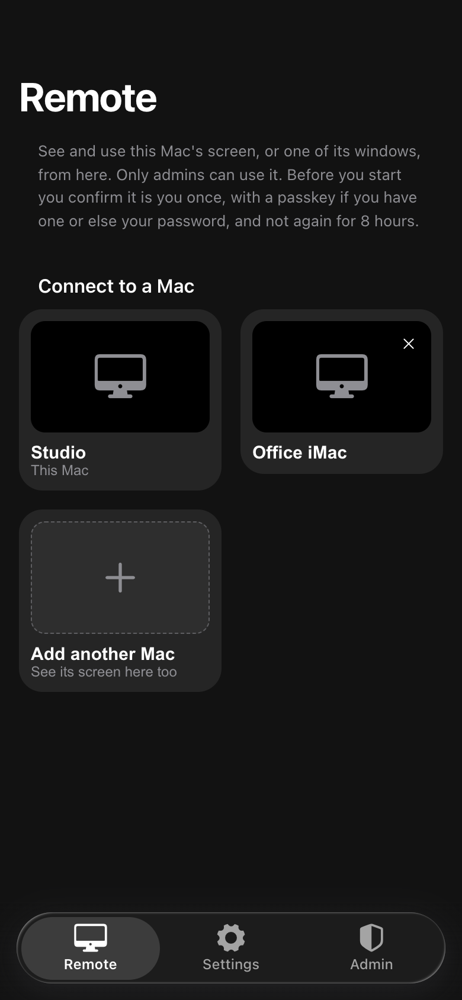
  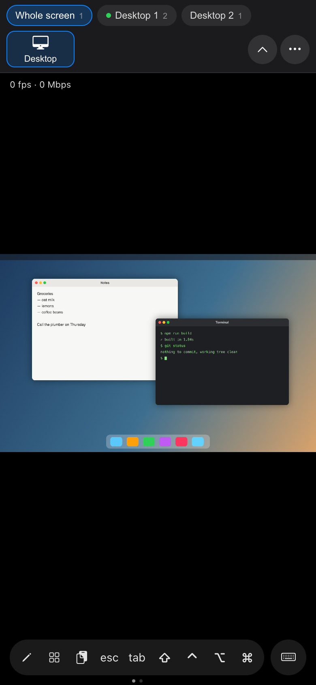
  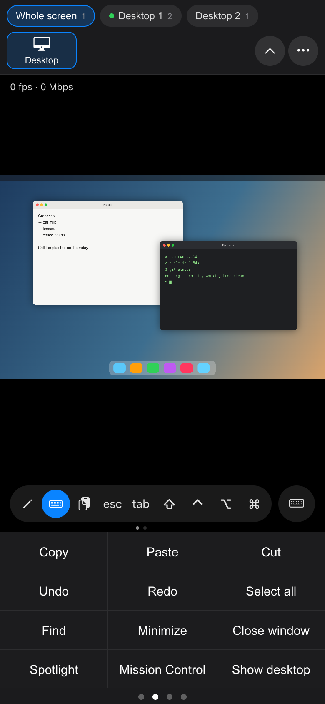
</p>

<p align="center">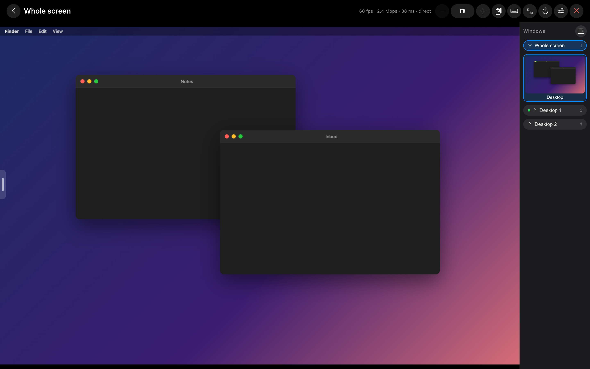</p>

On the Mac, the setup assistant and Settings:

<p align="center">
  <picture><source media="(prefers-color-scheme: dark)" srcset="docs/assets/shot-mac-role-dark.png">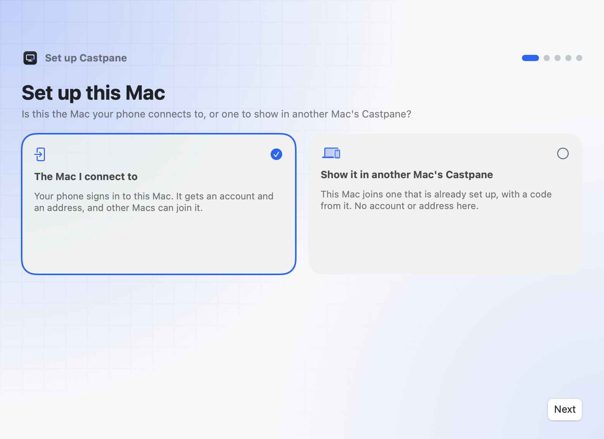</picture>
  <picture><source media="(prefers-color-scheme: dark)" srcset="docs/assets/shot-mac-setup-dark.png">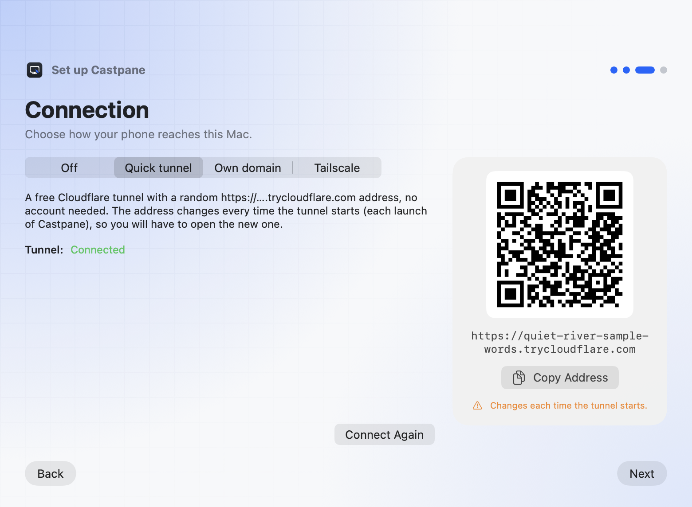</picture>
  <picture><source media="(prefers-color-scheme: dark)" srcset="docs/assets/shot-mac-activity-dark.png">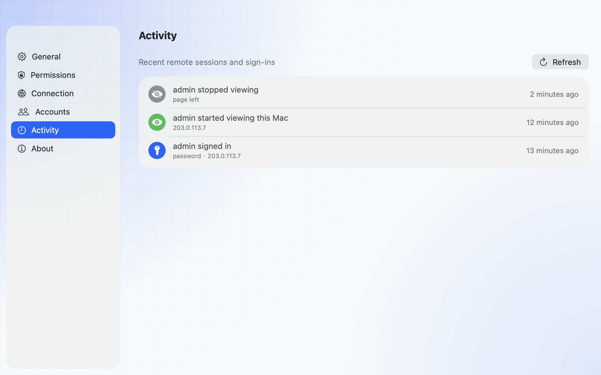</picture>
</p>

These pictures come from fixtures: the web app's from `npm run shots`, where the "Mac screen"
is drawn by the script, and the Mac app's from a debug build's snapshots, with a made-up
address. The animations under Features were recorded the same way, from the web app with
made-up answers and made-up Mac windows. No real screen was captured. On macOS 26 and later the app's panels and buttons are
Liquid Glass, which the snapshots do not draw.

## Requirements

- **The Mac:** macOS 14 or later, Apple silicon or Intel (one release image for each).
  Screen Recording and Accessibility permission for Castpane; optionally Files and Folders for
  the folders kept in the Dock, to open them from a phone.
- **To build it:** the Command Line Tools (Swift 6) and Node.js 22.18 or later.
- **The viewer:** a browser with WebCodecs (current Chrome, Edge, Safari 17 and later), over
  **HTTPS**. Browsers allow the video decoder, passkeys and the installable app only on HTTPS
  (or on the Mac itself, at `127.0.0.1`).

## Quick start

On a Mac with Apple silicon or Intel, with [Homebrew](https://brew.sh):

```sh
brew install --cask xxxxDev/tap/castpane     # Castpane then updates itself
```

Or download `Castpane-<version>-arm64.dmg` (or `-x86_64.dmg` for Intel) from the releases
page, drag Castpane to Applications and open it. Castpane then keeps itself up to date: it
checks GitHub once a day and installs a new version when you say so. The app is not notarized by Apple, so a downloaded copy's first
launch needs **System Settings › Privacy & Security › Open Anyway**;
[docs/setup.md](docs/setup.md#install) has the steps and what the Homebrew way skips.

Or build it from source (any Mac, Apple silicon or Intel):

```sh
git clone https://github.com/xxxxDev/castpane.git castpane && cd castpane
npm run setup            # installs the web tools and the server's packages
npm run build            # web/dist
mac/build-app.sh         # mac/build/Castpane.app, with this Mac's Node, server/ and web/dist
open mac/build/Castpane.app
```

The setup assistant first asks what this Mac is for. For the Mac you connect to, it then:

1. makes your Castpane account;
2. asks for Screen Recording and Accessibility (Castpane offers to restart after the first),
   and, if you want, the folders kept in the Dock;
3. asks how to connect: a quick tunnel, your own domain or Tailscale;
4. shows the address and a QR code. Open it on the phone, sign in, and use **Share › Add to
   Home Screen** for the app.

**Tailscale is the one we recommend.** Your phone and your Macs then talk to each other
directly, often over the same network, instead of through a server elsewhere: the picture is
smoother and reacts sooner. Between two Macs at home, a round trip took about 3 ms over
Tailscale and about 300 ms through a Cloudflare tunnel. Only your own devices can reach it,
and TLS ends on your Mac. The price is the Tailscale app on each device, connected while you
use Castpane. A Cloudflare tunnel needs nothing on the phone, for when that matters more.

[docs/setup.md](docs/setup.md) explains each connection mode and its trade-offs.

## Limits

Developer ID signing and notarization (releases are signed with the project's own
certificate instead), and audio.

## Documentation

- [docs/setup.md](docs/setup.md): installing, permissions, the three connection modes.
- [docs/multi-mac.md](docs/multi-mac.md): several Macs in one web app.
- [docs/security.md](docs/security.md): what Castpane guarantees, where its secrets are, and
  what it cannot stop.
- [docs/protocol.md](docs/protocol.md): the remote protocol, the app's local API, and the
  process contract.
- [docs/development.md](docs/development.md): layout, running from source, checking a change.
- [mac/README.md](mac/README.md): building the Mac app.
- [SECURITY.md](SECURITY.md): how to report a vulnerability.
- [CONTRIBUTING.md](CONTRIBUTING.md): how to propose a change.
- [BRAND.md](BRAND.md): the logo, which the MIT License does not cover.

## Security

Whoever signs in to its account can control your Mac, as you. See [SECURITY.md](SECURITY.md) for
the security model and how to report a vulnerability privately.

## Contributing

Bug reports and focused pull requests are welcome. See [CONTRIBUTING.md](CONTRIBUTING.md).

## License

The code is under the [MIT License](LICENSE). The Castpane logo (in this README, the app and
web icons) isn't: see [BRAND.md](BRAND.md). `server/` and `web/` grew from an MIT-licensed
shared PWA base whose notice is kept in the license file.

Made by [V-AX](https://v-ax.com).
