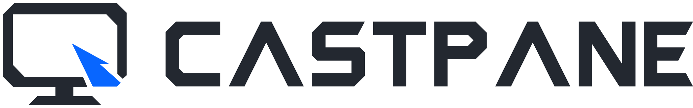
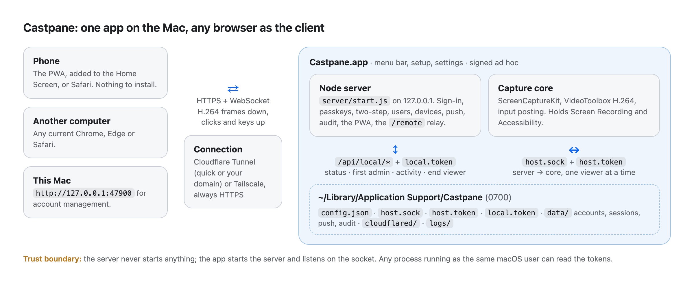
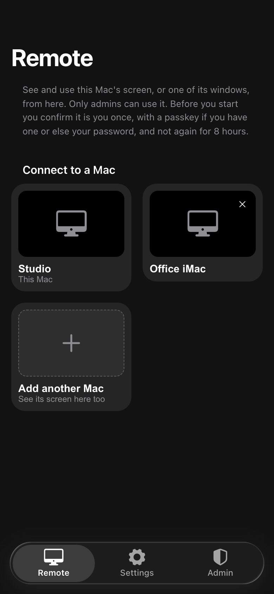
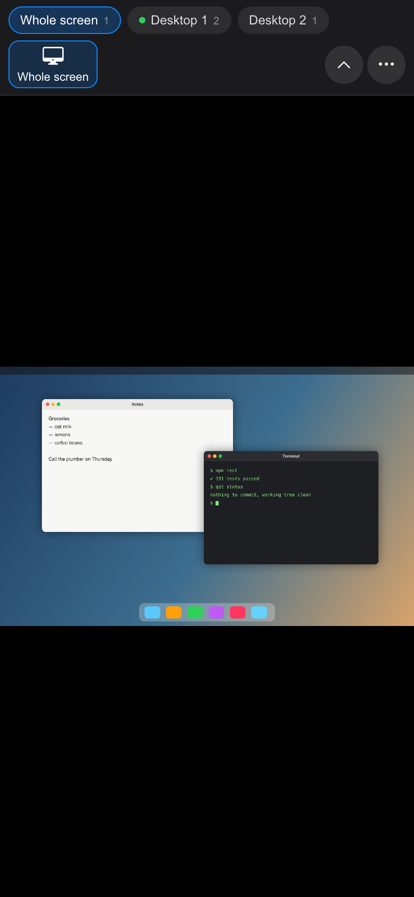
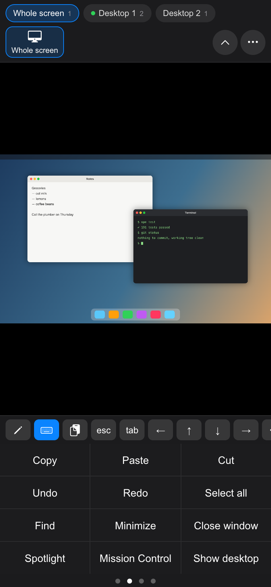
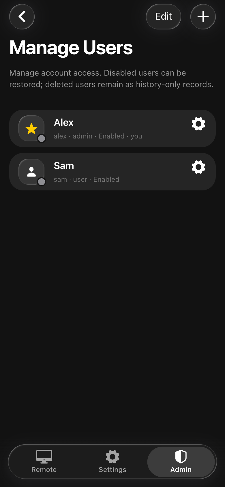
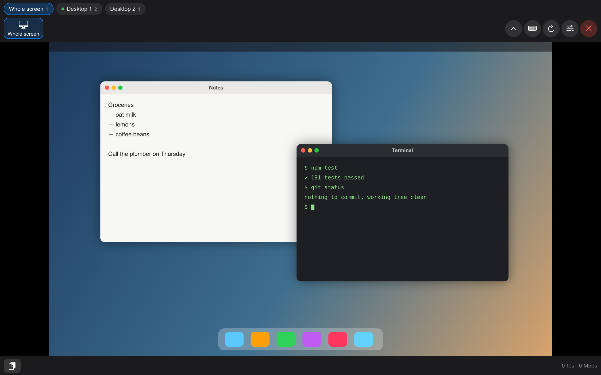
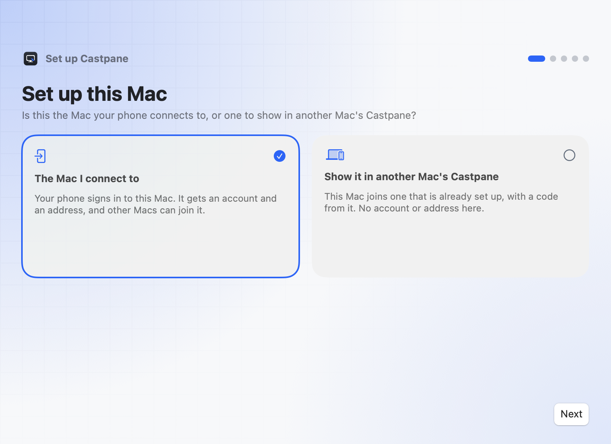
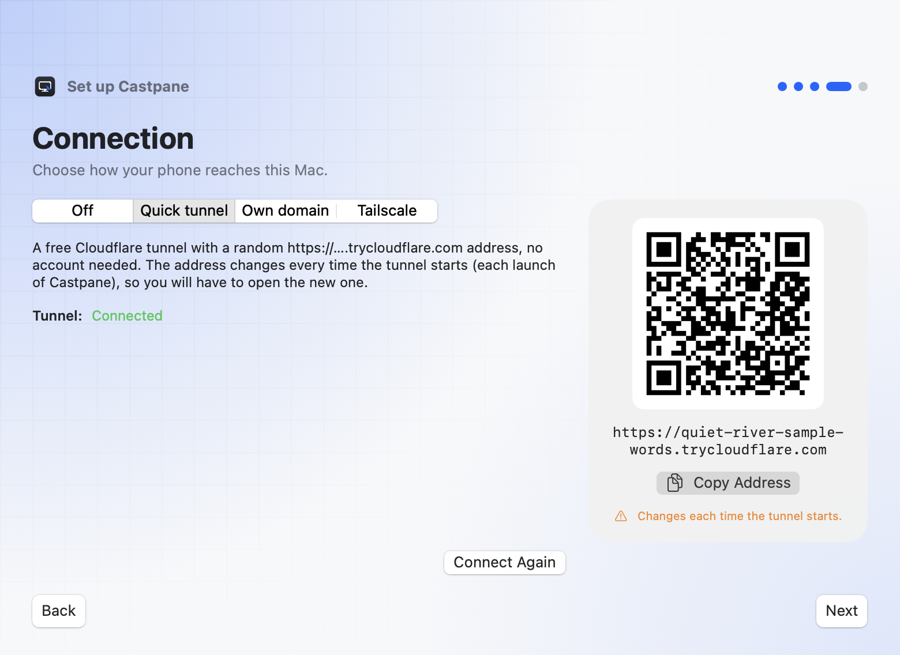
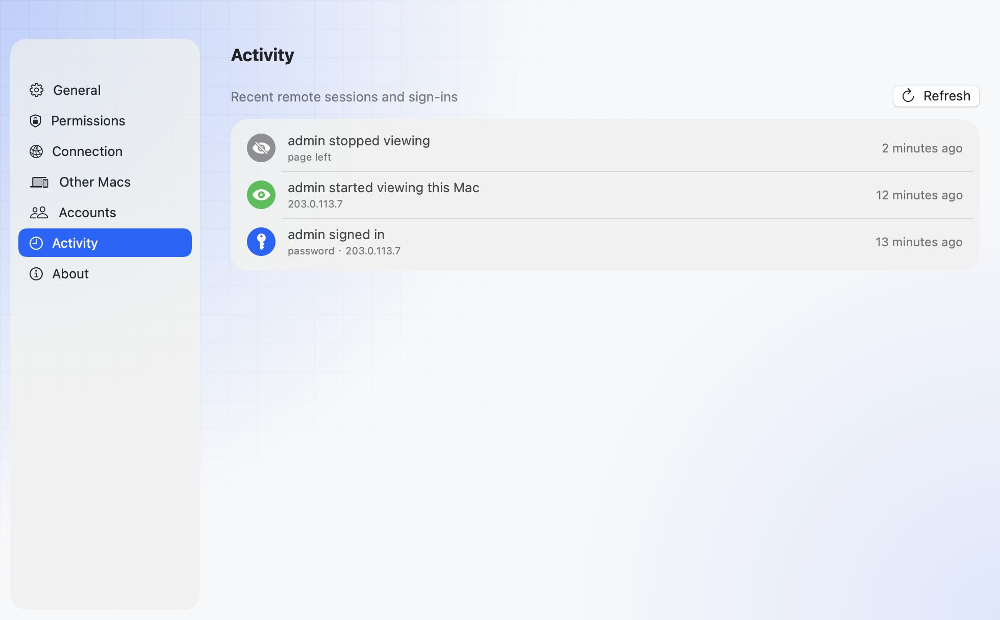

<p align="center">
  <picture>
    <source media="(prefers-color-scheme: dark)" srcset="docs/assets/logo/castpane-lockup-on-dark.svg">
    
  </picture>
</p>

<p align="center"><a href="README.md">English</a> · 繁體中文</p>

# Castpane

Castpane 讓你用手機或另一台電腦，看見並操作自己的 Mac。用瀏覽器打開就能用，也可以加到手機主畫面當 App。Mac 上只要裝一個 App：**Castpane.app**；手機或另一台電腦什麼都不用裝。

畫面用 Mac 自己的硬體 H.264 編碼，再由瀏覽器的硬體解碼器播放，所以不管是整個螢幕還是單一視窗，在手機上都清楚又即時。你可以點按、捲動、打字，還有專為小螢幕設計的觸控模式。

> [!WARNING]
> 以管理員身分登入的人，可以用你的身分完全控制你的 Mac。請用強密碼，開啟兩步驟登入或通行密鑰，對外開放前先讀 [docs/security.md](docs/security.md)。已經在你 Mac 上、以你的帳號執行的其他程式，Castpane 擋不住。

<p align="center">
  <picture><source media="(prefers-color-scheme: dark)" srcset="docs/assets/architecture-dark.png"></picture>
</p>

## 兩個部分

|                              | 是什麼                                                                                                                                                                    | 在哪裡                                 |
| ---------------------------- | ------------------------------------------------------------------------------------------------------------------------------------------------------------------------- | -------------------------------------- |
| **Castpane.app**（伺服器端） | 選單列 App。用 ScreenCaptureKit 擷取畫面、VideoToolbox 編碼，並送出你的點按和按鍵。它負責執行並守著網頁伺服器，也管理連線（Cloudflare 通道，或你為 Tailscale 填的網址）。 | [`mac/`](mac/) 和 [`server/`](server/) |
| **PWA**（用戶端）            | 用 Vue 和 Framework7 做的網頁 App：登入、遠端畫面、設定、帳號管理。手機或電腦上任何新版的 Chrome、Edge、Safari 都能用。                                                   | [`web/`](web/)                         |

## 功能

- **整個螢幕或單一視窗。** 可以選一個顯示器、一個桌面（Space）、一個全螢幕 App 或單一視窗。清單依桌面分組，附縮圖。
- **為手機設計。** 三種觸控模式：點哪裡就按哪裡（直接）、觸控板，或拖著下方圓圈移動的游標，手指不會擋住指的地方。可以雙指縮放；點到輸入框時鍵盤會自動跳出，並把輸入框放大到看得見的位置。另有一排手機沒有的按鍵（esc、tab、方向鍵、⌘ ⌥ ⌃ ⇧）、取代鍵盤的按鍵面板（編輯鍵、Mac 快捷鍵、數字鍵、F1–F12），以及可以先打好一整段字（含選字）再送到 Mac 游標位置的輸入框。手機橫拿時，分頁會移到右側直欄。
- **一個網頁 App 看多台 Mac。** 其他 Mac 用一次性的配對碼加入這台，就會出現在遠端頁裡，不需要自己的網址或帳號（[docs/multi-mac.md](docs/multi-mac.md)）。
- **剪貼簿雙向。** 把 Mac 的剪貼簿拷到手機，或把手機的放到 Mac。密碼工具標為隱藏的內容不會傳出，每次使用都記在「活動」裡。
- **畫面保持即時。** 每一格畫面顯示後都會回報；還有三格沒顯示時，Mac 就先跳過，所以網路慢的時候是格數變少，而不是畫面變舊。畫質、解析度和 30 或 60 fps 都可以自己選。
- **可靠的登入。** 密碼、通行密鑰（Face ID、Touch ID、Windows Hello）、兩步驟驗證碼和備用碼，以及從已登入的手機掃 QR code 登入。登入失敗會讓該位址被鎖得越來越久；管理員看得到被試了什麼、從哪裡來。
- **操作前再確認一次。** 打開遠端畫面時，要再用管理員的通行密鑰，或再輸入一次密碼和驗證碼。這張通行證有效 8 小時，而且只限這次登入。
- **一次只給一個人看。** 第二個頁面會接手第一個。Mac 的選單會顯示誰在看，也能立刻中斷。每次有人開始看，每位管理員都會收到通知，寫明是誰、從哪裡。
- **使用者和裝置。** 管理員和一般成員、停用和刪除的帳號，以及每個已登入的裝置，都能把它登出。只有管理員能打開遠端畫面。
- **可安裝的 App。** 加到主畫面就是有通知的全螢幕 App，有新版本時會提示更新。
- 網頁 App 有**英文和繁體中文**。

## 實際畫面

<p align="center">
  
  
  
  
</p>

<p align="center"></p>

Mac 上的設定精靈和設定視窗：

<p align="center">
  <picture><source media="(prefers-color-scheme: dark)" srcset="docs/assets/shot-mac-role-dark.png"></picture>
  <picture><source media="(prefers-color-scheme: dark)" srcset="docs/assets/shot-mac-setup-dark.png"></picture>
  <picture><source media="(prefers-color-scheme: dark)" srcset="docs/assets/shot-mac-activity-dark.png"></picture>
</p>

這些圖都來自假資料：網頁 App 的由 `npm run shots` 產生，「Mac 螢幕」是腳本畫的；Mac App 的來自除錯版的截圖功能，網址是編的。沒有擷取任何真實螢幕。在 macOS 26 以上，App 的面板和按鈕是 Liquid Glass 玻璃效果，截圖裡畫不出來。

## 需求

- **Mac：** macOS 14 以上，Apple 晶片或 Intel 都可以（各有一個 dmg）。Castpane 需要「螢幕錄製」和「輔助使用」權限。
- **編譯：** Command Line Tools（Swift 6）和 Node.js 22.18 以上。
- **觀看端：** 支援 WebCodecs 的瀏覽器（新版 Chrome、Edge、Safari 17 以上），而且要走 **HTTPS**。瀏覽器只在 HTTPS 上（或在 Mac 本機的 `127.0.0.1`）允許影像解碼、通行密鑰和安裝 App。

## 快速開始

在 Apple 晶片或 Intel 的 Mac 上，用 [Homebrew](https://brew.sh) 安裝：

```sh
brew install --cask xxxxDev/tap/castpane     # 之後 Castpane 會自己更新
```

或從 releases 頁下載 `Castpane-<版本>-arm64.dmg`（Intel 用 `-x86_64.dmg`），把 Castpane 拖進「應用程式」再打開。之後 Castpane 會自己保持最新：每天到 GitHub 檢查一次，你同意後就安裝新版。這個 App 沒有經過 Apple 公證，所以下載的版本第一次打開要到 **系統設定 › 隱私權與安全性 › 強制打開**；步驟和 Homebrew 方式省掉了什麼，見 [docs/setup.md](docs/setup.md#install)。

或從原始碼編譯（任何 Mac，Apple 晶片或 Intel 都可以）：

```sh
git clone https://github.com/xxxxDev/castpane.git castpane && cd castpane
npm run setup            # 安裝網頁工具和伺服器的套件
npm run build            # web/dist
mac/build-app.sh         # mac/build/Castpane.app，內含這台 Mac 的 Node、server/ 和 web/dist
open mac/build/Castpane.app
```

設定精靈會先問這台 Mac 的用途。選「你要連的這台」，接著會：

1. 建立你的管理員帳號；
2. 要求「螢幕錄製」和「輔助使用」權限（開好第一個後，Castpane 會提議重新啟動）；
3. 問你怎麼連線：快速通道、自己的網域或 Tailscale；
4. 顯示網址和 QR code。在手機上打開、登入，再用 **分享 › 加入主畫面** 安裝 App。

[docs/setup.md](docs/setup.md) 說明每種連線方式和它的取捨。

## 文件

文件目前只有英文。

- [docs/setup.md](docs/setup.md)：安裝、權限、三種連線方式。
- [docs/multi-mac.md](docs/multi-mac.md)：一個網頁 App 看多台 Mac。
- [docs/security.md](docs/security.md)：Castpane 保證什麼、機密放在哪裡、擋不住什麼。
- [docs/protocol.md](docs/protocol.md)：遠端協定、App 的本機 API、程序之間的約定。
- [docs/development.md](docs/development.md)：專案結構、從原始碼執行、怎麼檢查改動。
- [mac/README.md](mac/README.md)：編譯 Mac App。
- [BRAND.md](BRAND.md)：標誌，不在 MIT 授權範圍內。

## v0.1 還沒有的

Apple 開發者簽章和公證（release 改用專案自己的憑證簽名），以及聲音。

## 授權

MIT，請看 [LICENSE](LICENSE)。`server/` 和 `web/` 源自一個 MIT 授權的 PWA 共同基底，其授權聲明保留在授權檔裡。

Castpane 的標誌（本頁、App 和網頁圖示）屬於 [V-AX](https://v-ax.com)，**不在** MIT 授權範圍內，請看 [BRAND.md](BRAND.md)。
